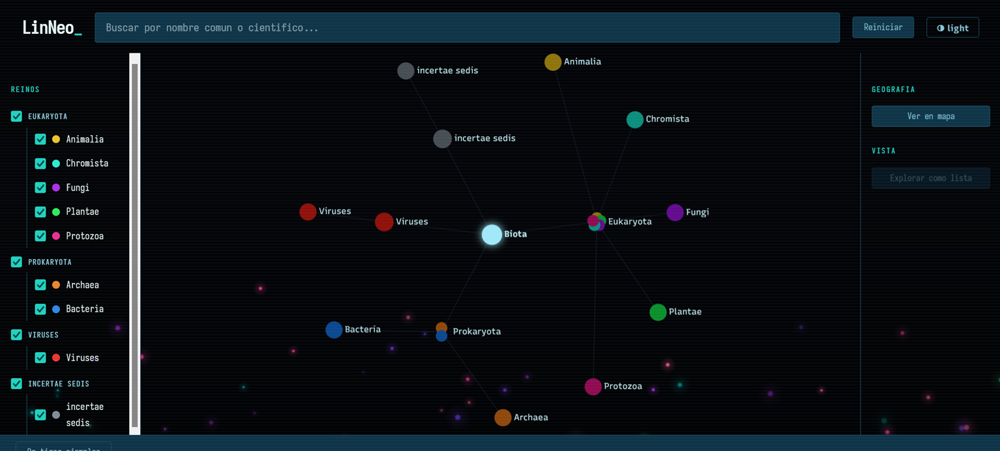
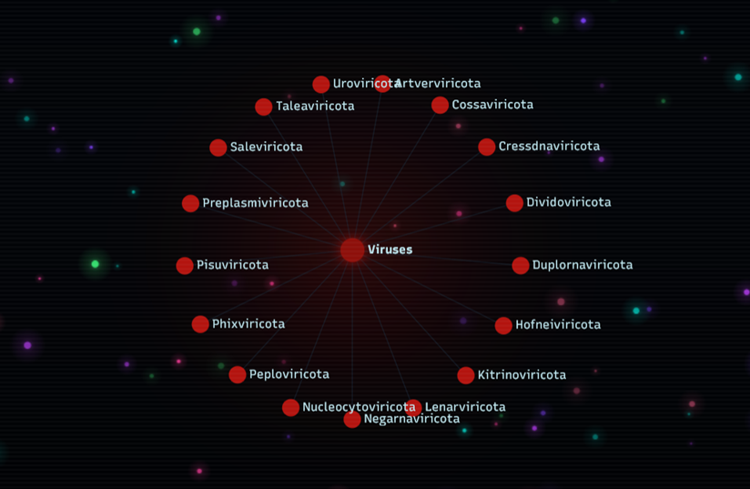
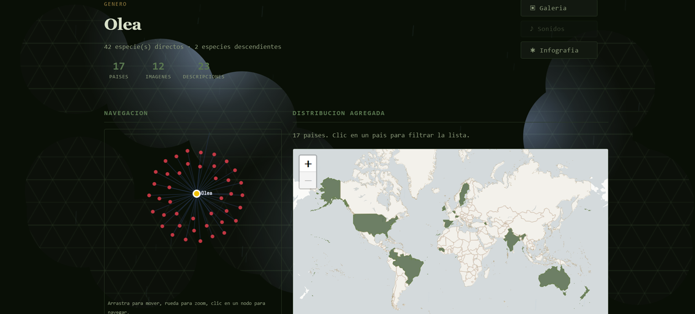
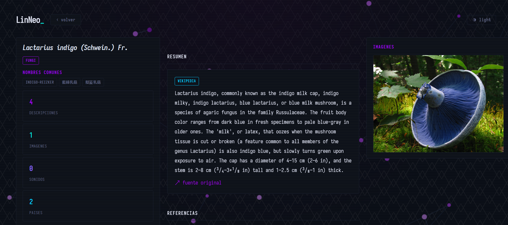
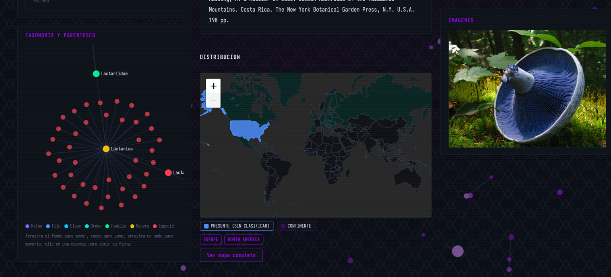
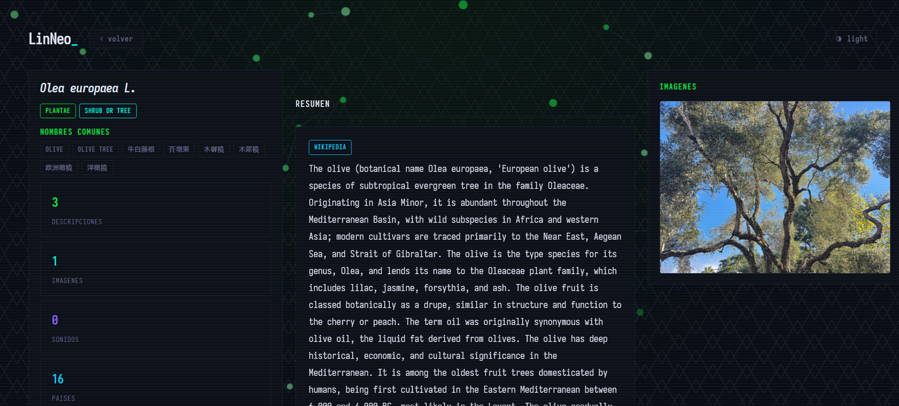
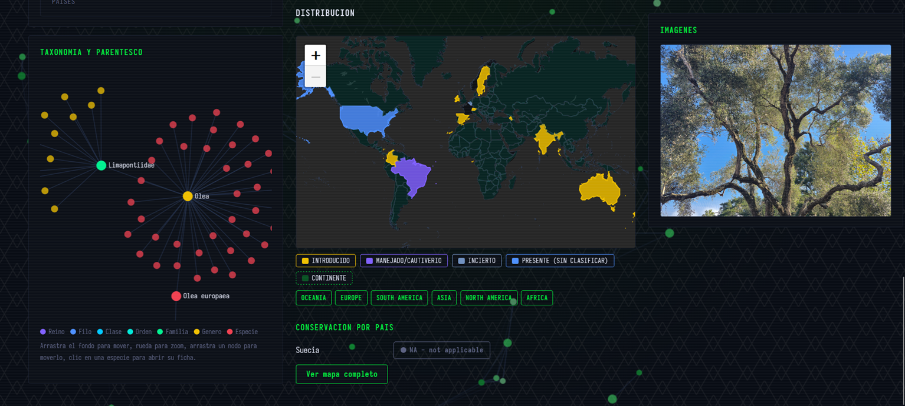
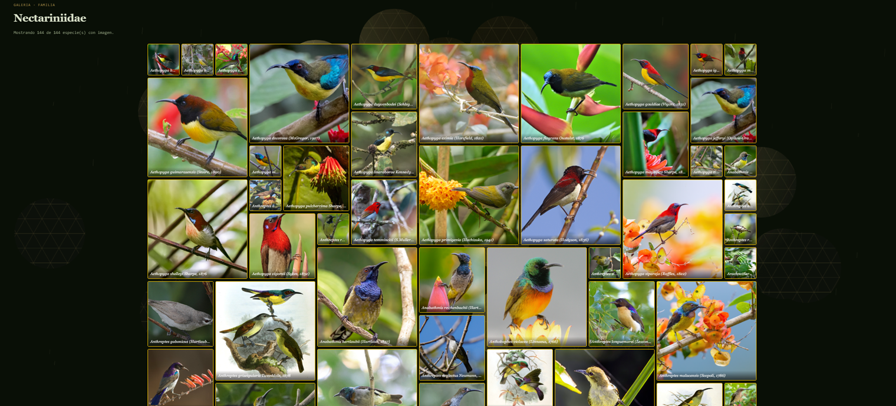
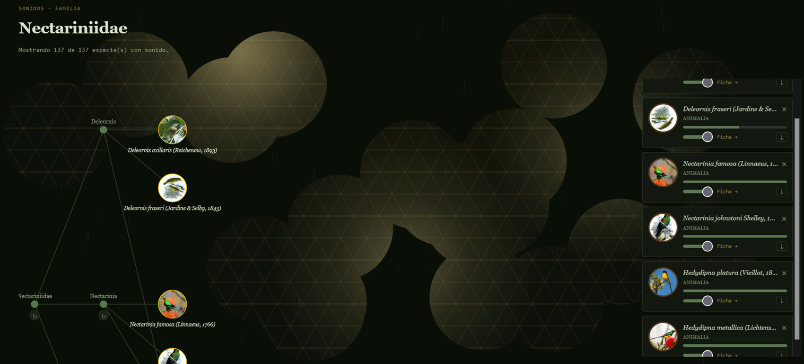
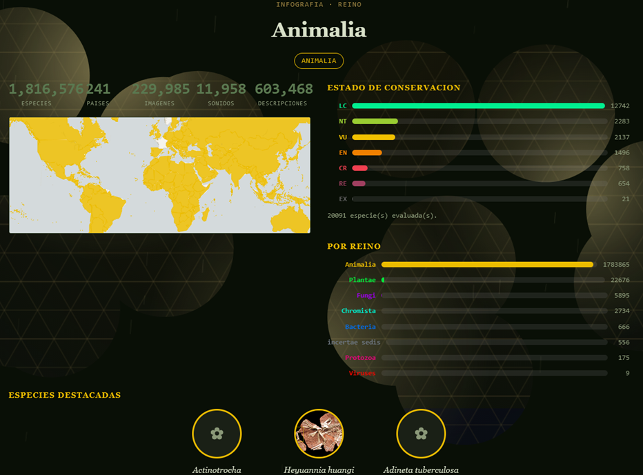

```
██╗     ██╗███╗   ██╗███╗   ██╗███████╗ ██████╗
██║     ██║████╗  ██║████╗  ██║██╔════╝██╔═══██╗
██║     ██║██╔██╗ ██║██╔██╗ ██║█████╗  ██║   ██║
██║     ██║██║╚██╗██║██║╚██╗██║██╔══╝  ██║   ██║
███████╗██║██║ ╚████║██║ ╚████║███████╗╚██████╔╝
╚══════╝╚═╝╚═╝  ╚═══╝╚═╝  ╚═══╝╚══════╝ ╚═════╝
        by RemLam (@RemiH06)        version 2.0
```

[](https://github.com/RemiH06/LinNeo)
[](https://github.com/RemiH06/LinNeo)
[](https://github.com/RemiH06/LinNeo)
[](LICENSE)
[](https://neo4j.com)
[](https://www.gbif.org)

## General description

**LinNeo** is a biodiversity knowledge graph with **~2.5 million species** from the
GBIF taxonomic backbone, each with its full hierarchy (Biota → Domain → Kingdom →
Phylum → Class → Order → Family → Genus → Species), geographic distribution,
conservation status, and, when available, description, common names, images, and sound.

It started as a research tool for my book **[100%](https://github.com/RemiH06/100)**
(private repo for now): understanding real-world biodiversity patterns to design
invented species and ecosystems with coherent foundations. It is consumed through an
API (FastAPI) and a web interface (React) navigable like the tree of life, with three
visual themes.

Full technical documentation: [`docs/index.html`](docs/index.html) (also published via
GitHub Pages).

## Screenshots

<!-- Stored in docs/img/ as ln_ss1.png ... ln_ss10.png -->
| | |
|---|---|
|  |  |
|  |  |
|  |  |
|  |  |
|  |  |

The infographic (`ln_ss10`) deliberately leaves the per-kingdom species count visible
instead of hiding it: it works as a visual diagnostic for the data cross-checks
described under Graph cleanup — if thousands of species show up whose declared kingdom
doesn't match the kingdom they're structurally reachable from, that's the pending
kingdom-misplacement issue, made visible right there instead of staying hidden in a
query.

## Architecture

| Layer | Technology | Role | Port |
|---|---|---|---|
| Database | Neo4j (database `linneo`) | Taxonomic graph + enrichment | 7687 / 7474 |
| Backend | FastAPI (uvicorn) | Translates HTTP requests into Cypher | 8035 |
| Frontend | React + Vite | UI, three themes, `/api` proxy → `localhost:8035` | 5135 |

Besides the running app there is an offline **data pipeline** (Python scripts + Cypher
loaders) that populates the database once from the GBIF backbone.

## Installation

```
- Requires Neo4j (Desktop or Enterprise) running locally before importing data.
- The full GBIF backbone requires a Neo4j heap of at least 4-8 GB.
```

1. Install Python dependencies: `pip install -r requirements.txt`
2. Create a Neo4j database named `linneo` (auth disabled or empty password locally).
3. Adjust heap in `neo4j.conf` if needed:
   ```
   server.memory.heap.initial_size=4G
   server.memory.heap.max_size=8G
   server.memory.pagecache.size=4G
   ```
4. Copy `.env.example` to `.env` at the project root (it's in `.gitignore`) and fill in the values.
5. Run the data pipeline (see details below) until Neo4j is loaded.
6. Start the backend:
   ```
   cd backend
   uvicorn app.main:app --reload --port 8035
   ```
7. Start the frontend:
   ```
   cd frontend
   npm install
   npm run dev                     # port 5135
   ```

## Data pipeline

```
download_all.py                 Orchestrates the enrichment fetchers
data_fetchers/                  One fetcher per source (Wikipedia, EOL, FishBase,
                                 POWO, AmphibiaWeb, Wikidata, Wikimedia, Xeno-canto)
backbone_extras.py               Extracts descriptions/vernaculars/images/refs/types
clean4neo4j.py                   Normalizes CSVs for LOAD CSV
db_loaders/                      Cypher loaders, one per source
repair/                          Graph integrity repair (see below)
```

Outputs in `biodiversity_data/`; nodes per rank in `taxonomy_nodes_by_rank/`.

## Data model (summary)

Hierarchy on a single `HAS_CHILD` plane from the root node `Biota`, through 4
`Domain` and 9 `Kingdom` nodes, down to each `Species`. Enrichment hangs off species:
`FOUND_IN` (country), `HAS_DESCRIPTION`, `HAS_MEDIA`.

**Key gotcha:** keys are not uniform. `family`, `genus`, and `species` use the GBIF
`taxonID` as their key; `kingdom`, `phylum`, `class`, `order`, and `domain` use small
in-house numbering. Any cross-reference with GBIF data must respect this.

Full detail on nodes, relationships, and per-kingdom colors is in the technical
documentation.

## Graph cleanup (summary)

The initial backbone load left the graph with nodes disconnected from their hierarchy:
the entire Fungi kingdom missing its `Kingdom` node, ~26,700 orphaned nodes across all
ranks, and thousands of nodes with more than one `HAS_CHILD` parent (duplication from
divergent backbone paths). The approach, reused for every variant of the problem, was
always the same pattern:

1. **Diagnose with Cypher** how many nodes are affected and of what type (orphan,
   multi-parent, misplaced) — never repair blindly.
2. **Cross-reference the backbone** (`Taxon.tsv`) by `taxonID` when the key matches;
   otherwise, **fall back to name + rank**, with a uniqueness safeguard to avoid
   grabbing homonyms from another kingdom.
3. **Walk up the chain** `parentNameUsageID`, skipping unmodeled ranks (subfamily,
   tribe, subgenus), until the first real ancestor.
4. **Generate CSV + idempotent Cypher** (never edit the graph by hand) so it can be
   re-run, audited, and reverted.

Result: 89% of orphans reconnected (23,867 of 26,747) and multi-parent nodes reduced
from thousands down to a handful of genuinely ambiguous cases, deliberately left
untouched rather than forcing an incorrect resolution. What's left is ambiguous
homonyms and UNITE environmental sequences — noise irrelevant to the project. Full
detail, scripts, and per-problem numbers are in the technical documentation.

## Features

- Navigate the tree of life from Biota to ~2.5M species with radial graphs.
- Species pages: taxonomy, distribution (242 countries), IUCN conservation status,
  multi-source/multilingual descriptions, images, sounds, and common names.
- Search with autocomplete (name and description content).
- Chained geographic filters: continent → country.
- Three themes: **shui** (home, oceanic), **bookworm** (reading, with mosaic
  galleries, a bird sound tree, and infographic posters per taxon), **elixir** (base).
- The entire UI is tinted according to the active kingdom.

## Current limitations

- **Unresolved loading performance**: detail-heavy views take a few seconds to load
  even when capped at a maximum of 250 species at a time. Fetching that much data
  efficiently hasn't been solved yet.
- ~1,346 orphan nodes remain unresolved (ambiguous homonyms + UNITE noise), plus
  ~33,300 species with kingdom misplacement still pending a fix (see challenges).
- Enrichment is partial: not every species has an image, sound, or description.
- The data is a snapshot; updating it requires re-running the pipeline.

Navigability and the interactive way of exploring the tree of life — graphs you can
focus and traverse node by node, maps, galleries, and live sound trees — is one of the
project's biggest strengths, even with that unresolved performance limitation.

## Project challenges

Summary of the biggest problems faced during development and their current state.
Full detail (diagnosis, numbers, scripts) is in the technical documentation.

| Challenge | Status |
|---|---|
| Entire Fungi kingdom disconnected (171,665 species with no Kingdom node) | Resolved |
| ~26,747 orphan nodes across all ranks | 89% resolved |
| Nodes with multiple parents across kingdoms (duplication) | ~99% resolved |
| Kingdom misplacement (~33,300 species with a single wrong parent) | Diagnosed, fix designed, execution pending |
| `MemoryPoolOutOfMemoryError` on the infographic when requesting a full kingdom | Resolved (per-phylum `CALL` subqueries) |
| Graph coloring didn't inherit by kingdom at depth | Resolved (structural-ancestor fallback) |
| Graph focus saturated for large kingdoms after reconnecting orphans | Resolved (children-per-node cap) |
| Race condition in the frontend search/graph | Resolved (operation counter) |
| Query performance for detail-heavy views | Unresolved (see limitations) |

## Future

- Deploy the project (GitHub Pages for the frontend; backend + Neo4j hosted).
- Consider submitting LinNeo to GBIF's [Ebbe Nielsen Challenge](https://www.gbif.org/ebbe-nielsen-challenge)
  once genomic information (DNA, chromosomes, sequences) is added as an extra
  enrichment layer on top of the existing species.
- Close the per-node children cap in `graph_focus` for large kingdoms.
- Additional bookworm views (more clade "toys").

## License

[AGPL-3.0](LICENSE)